# Database Schema - billscan-api

> Diagrama generado a partir del historial de migraciones de Alembic (14 migraciones).
> Última migración: `2d944ffc2411` (2026-09-06)

## Entity Relationship Diagram

```mermaid
erDiagram
    users {
        varchar id PK "VARCHAR(255)"
        varchar email UK "VARCHAR(255) NOT NULL"
        timestamptz created_at "DEFAULT NOW()"
    }

    fiscal_info {
        bigserial id PK
        varchar user_id FK "VARCHAR(255) NOT NULL"
        varchar rfc "VARCHAR(255) NOT NULL"
        varchar razon_social "VARCHAR(255) NOT NULL"
        varchar email "VARCHAR(255) NOT NULL"
        varchar cp "VARCHAR(255) NOT NULL"
        text address "NULLABLE"
        varchar use_cfdi_default "VARCHAR(50) DEFAULT 'G03'"
    }

    regimenes {
        bigserial id PK
        bigint fiscal_info FK "NOT NULL"
        varchar regimen_code "VARCHAR(255) NOT NULL"
        varchar regimen_description "VARCHAR(255) NOT NULL"
        date fecha_alta "NOT NULL"
    }

    merchants {
        bigserial id PK
        varchar name "VARCHAR(255) NOT NULL"
        text tax_id "NULLABLE"
        text address "NULLABLE"
        text branch_id "NULLABLE"
        varchar phone "VARCHAR(50) NULLABLE"
        timestamptz created_at "DEFAULT NOW()"
    }

    payment_methods {
        varchar code PK "VARCHAR(10)"
        varchar description "VARCHAR(100) NOT NULL"
    }

    receipts {
        bigserial id PK
        varchar receipt_uuid UK "VARCHAR(36) UNIQUE NOT NULL"
        varchar user_id FK "VARCHAR(255) NULLABLE"
        bigint merchant_id FK "NOT NULL"
        varchar payment_method_code FK "VARCHAR(10) NULLABLE"
        date transaction_date "NULLABLE"
        time transaction_time "NULLABLE"
        varchar ticket_number "VARCHAR(100)"
        varchar pos_id "VARCHAR(50)"
        varchar cashier "VARCHAR(100)"
        numeric subtotal "NUMERIC(15,2)"
        numeric total_discount "NUMERIC(15,2) DEFAULT 0"
        numeric total "NUMERIC(15,2) NOT NULL"
        numeric amount_paid "NUMERIC(15,2) NOT NULL"
        numeric change "NUMERIC(15,2)"
        varchar card_last_four "VARCHAR(10)"
        varchar authorization_code "VARCHAR(100)"
        text context_notes "NULLABLE"
        jsonb extra_metadata "NULLABLE"
        timestamptz created_at "DEFAULT NOW()"
        timestamptz updated_at "DEFAULT NOW()"
    }

    receipt_payments {
        bigserial id PK
        bigint receipt_id FK "NOT NULL"
        varchar payment_method_code FK "VARCHAR(10) NOT NULL"
        numeric amount "NUMERIC(15,2) NOT NULL"
        varchar card_last_four "VARCHAR(10)"
        varchar authorization_code "VARCHAR(100)"
        timestamptz created_at "DEFAULT NOW()"
    }

    receipt_billing_details {
        bigint receipt_id PK "FK"
        boolean is_billable "DEFAULT FALSE"
        boolean has_qr_code "DEFAULT FALSE"
        text billing_url "NULLABLE"
        text barcode "NULLABLE"
        text billing_code "NULLABLE"
        date expiration_date "NULLABLE"
        jsonb billing_metadata "NULLABLE"
        varchar facturagpt_session_id "VARCHAR(100)"
        varchar billing_status "VARCHAR(50) DEFAULT 'NOT_REQUESTED'"
        varchar billing_error_code "VARCHAR(100)"
        text billing_error_message "NULLABLE"
        timestamptz updated_at "DEFAULT NOW()"
        jsonb cfdi_summary "NULLABLE"
        timestamptz completed_at "NULLABLE"
    }

    billing_files {
        bigserial id PK
        bigint receipt_id FK "NOT NULL"
        varchar file_type "VARCHAR(10) NULLABLE"
        varchar file_key "VARCHAR(255) NOT NULL"
        varchar mime_type "VARCHAR(50)"
        timestamptz created_at "DEFAULT NOW()"
    }

    receipt_items {
        bigserial id PK
        bigint receipt_id FK "NOT NULL"
        float quantity "NOT NULL"
        varchar description "VARCHAR(500) NOT NULL"
        varchar sku "VARCHAR(100)"
        numeric unit_price "NUMERIC(15,2)"
        numeric total_price "NUMERIC(15,2) NOT NULL"
        numeric discount "NUMERIC(15,2) DEFAULT 0"
        jsonb item_metadata "NULLABLE"
    }

    receipt_taxes {
        bigserial id PK
        bigint receipt_id FK "NOT NULL"
        varchar tax_name "VARCHAR(50) NOT NULL"
        numeric tax_rate "NUMERIC(5,2)"
        numeric amount "NUMERIC(15,2) NOT NULL"
    }

    receipt_images {
        bigserial id PK
        bigint receipt_id FK "NULLABLE"
        varchar file_key "VARCHAR(255) NOT NULL"
        varchar mime_type "VARCHAR(50) DEFAULT 'image/jpeg'"
        int page_number "DEFAULT 1"
        timestamptz created_at "DEFAULT NOW()"
        bigint receipt_job_id FK "NOT NULL"
    }

    receipt_jobs_details {
        bigserial id PK
        varchar user_id FK "VARCHAR(255) NOT NULL"
        varchar job_name "VARCHAR(255) NOT NULL"
        text status "CHECK: RECEIVED|EXTRACTING|COMPLETED|FAILED"
        text error_message "NULLABLE"
        bigint receipt_id FK "NULLABLE"
        timestamptz created_at "DEFAULT NOW()"
        timestamptz updated_at "DEFAULT NOW()"
    }

    facturagpt_webhooks {
        varchar idempotency_key PK "VARCHAR(255)"
        varchar event_type "VARCHAR(50) NOT NULL"
        varchar session_id "VARCHAR(100) NOT NULL"
        jsonb payload "NOT NULL"
        timestamptz processed_at "NULLABLE"
        timestamptz received_at "DEFAULT NOW()"
        text last_error "NULLABLE"
        bigint receipt_id FK "NULLABLE"
    }

    billing_attempts {
        bigserial id PK
        bigint receipt_id FK "NOT NULL"
        varchar session_id "VARCHAR(100)"
        varchar status "VARCHAR(50) NOT NULL"
        timestamptz attempted_at "DEFAULT NOW()"
        varchar error_code "VARCHAR(100)"
        text error_message "NULLABLE"
        jsonb response_payload "NULLABLE"
    }

    users ||--o{ fiscal_info : "has"
    users ||--o{ receipts : "has"
    users ||--o{ receipt_jobs_details : "has"

    fiscal_info ||--o{ regimenes : "has"

    merchants ||--o{ receipts : "has"

    payment_methods ||--o{ receipts : "has"
    payment_methods ||--o{ receipt_payments : "has"

    receipts ||--o{ receipt_payments : "has"
    receipts ||--|| receipt_billing_details : "has"
    receipts ||--o{ billing_files : "has"
    receipts ||--o{ receipt_items : "has"
    receipts ||--o{ receipt_taxes : "has"
    receipts ||--o{ receipt_images : "has"
    receipts ||--o{ billing_attempts : "has"

    receipts ||--o{ receipt_jobs_details : "has"
    receipts ||--o{ facturagpt_webhooks : "has"

    receipt_jobs_details ||--o{ receipt_images : "has"
```

## Relaciones

| Tabla padre | Tabla hijo | FK | On Delete |
|-------------|-----------|-----|-----------|
| `users` | `fiscal_info` | `user_id` | RESTRICT |
| `users` | `receipts` | `user_id` | CASCADE |
| `users` | `receipt_jobs_details` | `user_id` | CASCADE |
| `fiscal_info` | `regimenes` | `fiscal_info` | RESTRICT |
| `merchants` | `receipts` | `merchant_id` | RESTRICT |
| `payment_methods` | `receipts` | `payment_method_code` | SET NULL |
| `payment_methods` | `receipt_payments` | `payment_method_code` | RESTRICT |
| `receipts` | `receipt_payments` | `receipt_id` | CASCADE |
| `receipts` | `receipt_billing_details` | `receipt_id` | CASCADE |
| `receipts` | `billing_files` | `receipt_id` | CASCADE |
| `receipts` | `receipt_items` | `receipt_id` | CASCADE |
| `receipts` | `receipt_taxes` | `receipt_id` | CASCADE |
| `receipts` | `receipt_images` | `receipt_id` | CASCADE |
| `receipts` | `receipt_jobs_details` | `receipt_id` | SET NULL |
| `receipts` | `billing_attempts` | `receipt_id` | CASCADE |
| `receipts` | `facturagpt_webhooks` | `receipt_id` | SET NULL |
| `receipt_jobs_details` | `receipt_images` | `receipt_job_id` | CASCADE |

## Notas de diseño

- **`receipts.user_id`** es nullable porque en el flujo MVP el usuario puede no estar autenticado al momento de crear el receipt.
- **`receipt_images.receipt_id`** es nullable porque las imágenes se insertan al crear el job de extracción, antes de que exista el receipt. Se backfilla al completar la extracción.
- **`receipt_images.receipt_job_id`** referencia a la tabla de jobs para trazabilidad del pipeline de procesamiento.
- **`facturagpt_webhooks.processed_at`** es nullable: NULL indica que el webhook fue recibido pero aún no procesado correctamente.
- **`facturagpt_webhooks.receipt_id`** usa SET NULL para no bloquear borrados de receipts (la tabla de webhooks es solo auditoría).
- **`billing_files`** tiene un índice único parcial `(receipt_id, file_type) WHERE file_type IS NOT NULL` para garantizar un solo XML y un solo PDF por receipt.
- **`merchants`** no tiene constraints únicos compuestos; originalmente tenía `UNIQUE(tax_id, branch_id)` pero fue eliminado en la migración #8.
